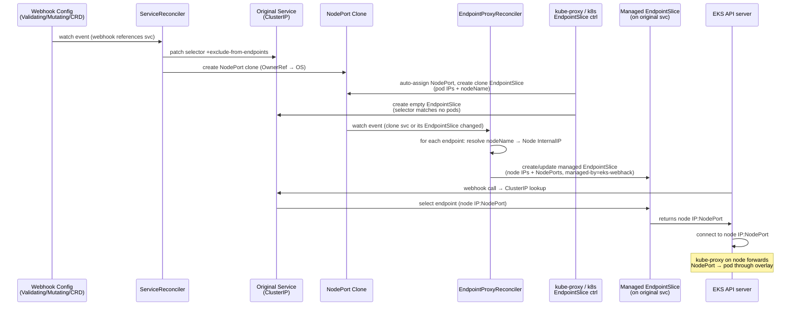

# eks-webhack

A Kubernetes operator that makes admission and conversion webhooks reachable from the EKS control plane when pods run on an overlay-network CNI (Calico, Cilium non-native routing, etc.).

---

## Problem

When EKS is configured with a custom CNI that uses overlay networking, pod IPs live inside a virtual network that is **not routable** from the AWS-managed control plane. The control plane communicates with worker nodes through a VPC ENI, so it can reach node IPs and NodePort traffic — but not pod IPs directly.

Kubernetes webhook configurations (Validating, Mutating, CRD conversion) reference a Service by name. The API server resolves that Service to an endpoint IP and opens a TLS connection to call the webhook. In a default setup the endpoint IP is a **pod IP**, which the EKS control plane cannot route to:

```
EKS API server ──► ClusterIP ──► EndpointSlice (pod IPs) ──✗ overlay network
```

The webhook call fails with a connection-refused or timeout error, and requests that trigger that webhook are rejected.

---

## Solution

eks-webhack transparently re-routes webhook traffic through NodePort services on real node IPs, which **are** reachable from the control plane via VPC routing.

Two controllers work together:

### ServiceReconciler

Watches all Services and all webhook configurations (`ValidatingWebhookConfiguration`, `MutatingWebhookConfiguration`, CRD conversion webhooks). For every ClusterIP Service that backs a webhook it:

1. Injects `vlair.io/exclude-from-endpoints: "true"` into the Service's `spec.selector` — no pod matches this, so the built-in EndpointSlice controller produces an **empty** slice for the original Service.
2. Creates a **NodePort clone** of the Service (same selector, same ports, type `NodePort`) with an `OwnerReference` back to the original. Kubernetes assigns node ports automatically.
3. Adds a finalizer so the selector is cleanly restored if the Service stops being webhook-backing.

When the Service is no longer referenced by any webhook the controller restores the original selector and deletes the clone.

### EndpointProxyReconciler

Watches the NodePort clone Services and their EndpointSlices. For each endpoint in a clone's slice:

1. Reads `endpoint.NodeName` (a standard EndpointSlice field populated by kube-proxy).
2. Looks up the Node and reads its `InternalIP` (falls back to `ExternalIP`).
3. Writes a **translated EndpointSlice** onto the original Service's namespace with:
   - `addresses`: node IP (VPC-routable)
   - `ports`: NodePort values (not container ports)
   - `endpointslice.kubernetes.io/managed-by: eks-webhack` — the built-in controller ignores slices with a non-standard `managed-by` value, so our slice survives reconciliation.
4. Deduplicates: multiple pods on the same node produce a single node-IP endpoint.

The result:

```
EKS API server ──► ClusterIP ──► EndpointSlice (node IPs + NodePorts) ──► kube-proxy ──► pod
```

TLS validation is unaffected — the Kubernetes API server validates the webhook certificate against the Service DNS name (from `clientConfig.service`), not the TCP destination address.

---

## Sequence



---

## Labels and annotations

| Label / Annotation | Set on | Value | Purpose |
|---|---|---|---|
| `vlair.io/managed-by` | NodePort clone, managed EPS | `eks-webhack` | Identifies resources owned by this operator |
| `vlair.io/original-service` | NodePort clone | original Service name | Links clone back to source |
| `vlair.io/source-service` | Managed EndpointSlice | NodePort clone name | Links EPS back to clone for stale cleanup |
| `vlair.io/exclude-from-endpoints` | Injected into original Service selector | `"true"` | Prevents any pod from matching; makes built-in EPS controller produce empty slice |
| `endpointslice.kubernetes.io/managed-by` | Managed EndpointSlice | `eks-webhack` | Non-standard value causes built-in EPS controller to leave our slice alone |
| `kubernetes.io/service-name` | Managed EndpointSlice | original Service name | Associates our slice with the original Service for kube-proxy and the API server |
| `vlair.io/webhook-proxy` (finalizer) | Original Service | — | Ensures selector is restored before the Service is removed from our watch |

---

## Getting started

### Prerequisites

- Go 1.23+
- `setup-envtest` (installed automatically by `make envtest`)
- Helm 3 (for chart operations)
- Docker (for image builds)

### Run tests

```bash
make test
```

### Build binary

```bash
make binary          # outputs bin/eks-webhack
```

### Build and push container image

```bash
make docker-build IMAGE_REPO=your-registry/eks-webhack IMAGE_TAG=v0.1.0
make docker-push  IMAGE_REPO=your-registry/eks-webhack IMAGE_TAG=v0.1.0
```

### Deploy with Helm

```bash
helm install eks-webhack helm/eks-webhack \
  --namespace eks-webhack \
  --create-namespace \
  --set image.repository=your-registry/eks-webhack \
  --set image.tag=v0.1.0
```

---

## Helm values

| Value | Default | Description |
|---|---|---|
| `replicaCount` | `2` | Number of manager replicas. At least 2 recommended for HA; leader election ensures only one is active. |
| `image.repository` | `ghcr.io/martin31821/eks-webhack` | Container image repository. |
| `image.tag` | `""` | Image tag. Defaults to `Chart.AppVersion` when empty. |
| `image.pullPolicy` | `IfNotPresent` | Image pull policy. |
| `imagePullSecrets` | `[]` | List of image pull secret names. |
| `serviceAccount.create` | `true` | Create a dedicated ServiceAccount. |
| `serviceAccount.name` | `""` | Override ServiceAccount name. Defaults to the full release name. |
| `serviceAccount.annotations` | `{}` | Annotations on the ServiceAccount (e.g. for IRSA). |
| `podAnnotations` | `{}` | Extra annotations on controller pods. |
| `podSecurityContext.runAsNonRoot` | `true` | Require non-root UID. |
| `podSecurityContext.seccompProfile.type` | `RuntimeDefault` | Seccomp profile. |
| `securityContext.allowPrivilegeEscalation` | `false` | Block privilege escalation. |
| `securityContext.capabilities.drop` | `["ALL"]` | Drop all Linux capabilities. |
| `securityContext.readOnlyRootFilesystem` | `true` | Read-only root filesystem. |
| `resources.requests.cpu` | `10m` | CPU request. |
| `resources.requests.memory` | `64Mi` | Memory request. |
| `resources.limits.memory` | `128Mi` | Memory limit (no CPU limit to avoid throttling). |
| `leaderElection.enabled` | `true` | Enable leader election (required for `replicaCount > 1`). |
| `metricsBindAddress` | `":8080"` | Address for the Prometheus metrics endpoint. |
| `healthProbeBindAddress` | `":8081"` | Address for `/healthz` and `/readyz` probes. |
| `nodeSelector` | `{}` | Node selector for controller pods. |
| `tolerations` | `[]` | Tolerations for controller pods. |
| `affinity` | pod anti-affinity by hostname | Affinity rules. Default spreads replicas across nodes. |

---

## Make targets

| Target | Description |
|---|---|
| `make build` | Compile all packages (`go build ./...`). |
| `make binary` | Build a static binary to `bin/eks-webhack`. |
| `make test` | Run all tests with envtest (downloads binaries automatically). Writes `cover.out`. |
| `make test-verbose` | Same as `test` but with full Ginkgo output (`--ginkgo.v`). |
| `make vet` | Run `go vet ./...`. |
| `make fmt` | Format all Go source files in-place. |
| `make fmt-check` | Check formatting without modifying files (useful in CI). |
| `make envtest` | Install `setup-envtest` if missing and download the configured API server binaries. |
| `make docker-build` | Build the container image tagged `IMAGE_REPO:IMAGE_TAG`. |
| `make docker-push` | Push the container image. |
| `make helm-lint` | Run `helm lint` on the chart. |
| `make helm-template` | Render the chart templates to stdout. |
| `make helm-package` | Package the chart into `dist/`. |
| `make clean` | Remove `bin/`, `dist/`, and `cover.out`. |

**Variables you can override:**

```bash
make test IMAGE_REPO=my-reg/eks-webhack IMAGE_TAG=dev ENVTEST_K8S_VERSION=1.30
```

| Variable | Default | Description |
|---|---|---|
| `IMAGE_REPO` | `ghcr.io/martin31821/eks-webhack` | Container image repository. |
| `IMAGE_TAG` | `git describe --tags --always --dirty` | Image tag. Falls back to `dev` outside a git repo. |
| `ENVTEST_K8S_VERSION` | `1.31` | Kubernetes version for envtest binaries. |
| `ENVTEST_ASSETS` | `/tmp/envtest-bins/k8s` | Directory where envtest binaries are cached. |
| `GOFLAGS` | `` | Extra flags passed to every `go` invocation (e.g. `-race`). |

---

## Architecture notes

- **No CRDs required.** The operator uses only labels and annotations on standard Kubernetes objects.
- **No webhook server required.** The operator itself does not register any admission webhooks.
- **Safe for existing traffic.** The selector patch happens atomically before the clone is created, and the clone's EndpointSlice is populated by Kubernetes automatically. The managed EndpointSlice on the original Service is created immediately after.
- **HA / leader election.** Multiple replicas can run; only the leader holds the reconcile loops. Lease stored in the operator namespace. The `--leader-election-namespace` flag (or `POD_NAMESPACE` env var) controls where the `Lease` object is created.
- **Cleanup on removal.** When a Service stops being webhook-backing (webhook config deleted or updated), the controller restores the original selector and removes the NodePort clone. Owned resources are also garbage-collected via `OwnerReference`.
